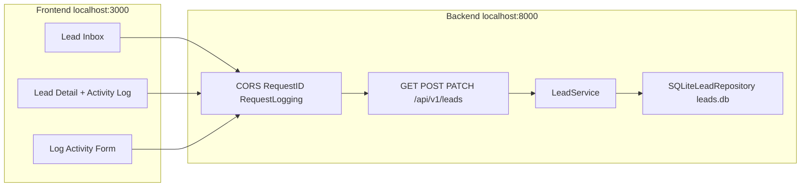

# System Design: Keyloop Sales Lead Management Tool

Local development architecture for Scenario C (Domain: Demand).

## Architecture

### Components

- **Next.js Pages app**: salesperson workspace (inbox + detail pane).
- **FastAPI**: REST API, Pydantic v2 validation, OpenAPI `/docs`.
- **LeadService**: list/filter/search, detail with activities, status update, activity persist.
- **SQLiteLeadRepository**: parameterized SQL, WAL, local `backend/leads.db`.

## Data flow

1. Website-style `POST /api/v1/leads` stores a lead (`status=new`).
2. Inbox `GET /api/v1/leads?status=&q=` returns newest-first pages.
3. Click lead: `GET /api/v1/leads/{id}` returns lead plus activities ordered by `createdAt` ASC.
4. Log activity: `POST /api/v1/leads/{id}/activities` inserts a row; call/email on `new` moves status to `contacted`.

### Tables

- `leads`: id, name, email, phone, message, vehicleInterest, status, attribution, createdAt
- `lead_activities`: id, lead_id FK, type, summary, notes, createdBy, createdAt

## Technology choices

| Choice | Why |
|--------|-----|
| FastAPI + Pydantic v2 | Typed REST + OpenAPI `/docs` for evaluators |
| SQLite + repository | Zero-cloud local clone/run; swap store later without changing service |
| Next.js + TanStack Query | Inbox pending/error/empty/content with shared query keys |
| Tailwind tokens `#00B5D8` | Dealership accent via `.bg-blue-20` |

## Observability (local)

- `X-Request-ID` on every response and error body.
- `RequestLoggingMiddleware`: `[request_id] --> / <-- (duration_ms)`, PII-masked bodies.
- Critical-path `structlog`: `lead_created`, `lead_status_updated`, `lead_activity_logged`, `db_operation_failed`.
- Future: `/metrics` histograms and OpenTelemetry spans around `LeadService` (not in this local slice).

## Assumptions

- Single dealership workspace (no multi-tenant auth).
- First outbound call/email on a `new` lead auto-transitions to `contacted`.
- Activities are append-only.

## GenAI in design

- Challenge docs cached in `AGENTS.md` / `context-summary.md` to avoid re-scanning.
- Lead schemas, logging middleware, and inbox UX reused from an existing local slice.
- Walkthrough video uses VieNeu TTS, local fonts, and FFmpeg.
- Composer 2.5 constrained by `.cursor/rules` and `scripts/verify.py` gates.
